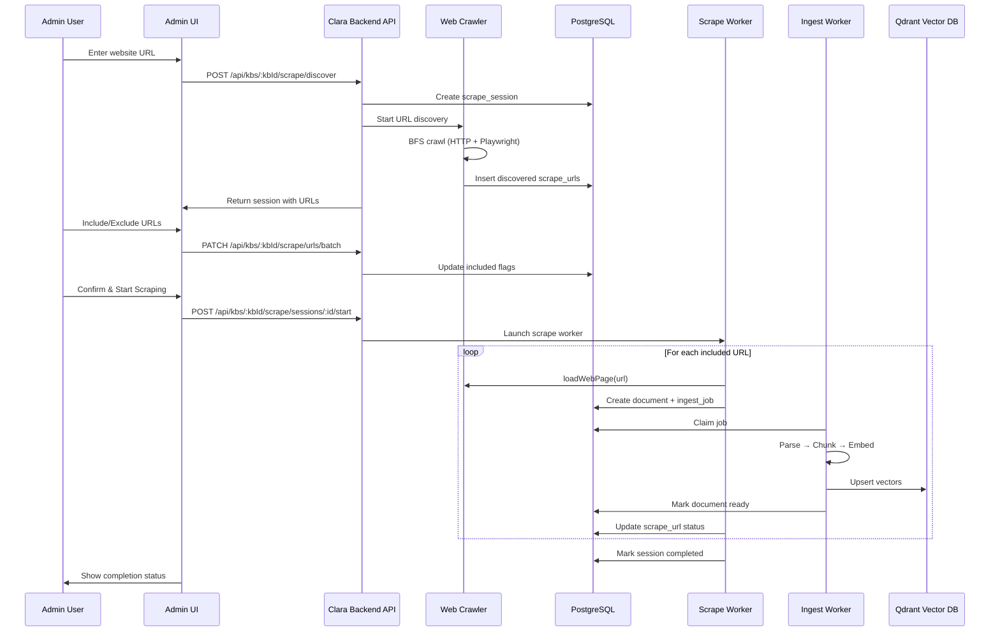

# Universal Website Scraping for Clara RAG Pipeline

Build a complete web scraping system that can crawl **any deployed website** (Node, Next.js, Vite, Django, ASP.NET, static HTML, etc.), discover all sub-URLs, let users select pages to include, and ingest the content as RAG documents into the existing `Organization → Project → KB → Document` pipeline.

## Current State (What Already Exists)

| Component | Location | Capability |
|---|---|---|
| Single-page scraper | [web-loader.ts](file:///c:/Users/moham/Documents/MyProjects/Workpace/clara-platform/clara-backend/src/modules/admin/core/ingest/web-loader.ts) | HTTP fetch + Playwright fallback, Cheerio text extraction |
| CLI ingest script | [scripts/ingest-web.ts](file:///c:/Users/moham/Documents/MyProjects/Workpace/clara-platform/clara-backend/scripts/ingest-web.ts) | Single-URL ingestion to Qdrant |
| Document model | [documents-db.ts](file:///c:/Users/moham/Documents/MyProjects/Workpace/clara-platform/clara-backend/src/modules/knowledge-bases/core/documents-db.ts) | Supports `sourceType: 'url'` |
| Ingest worker | [ingest-worker.ts](file:///c:/Users/moham/Documents/MyProjects/Workpace/clara-platform/clara-backend/src/modules/knowledge-bases/worker/ingest-worker.ts) | Job queue with `FOR UPDATE SKIP LOCKED` |
| Embed + upsert | [vector-store-kb.ts](file:///c:/Users/moham/Documents/MyProjects/Workpace/clara-platform/clara-backend/src/modules/admin/core/vector-store-kb.ts) | Batch embed → Qdrant upsert |
| Parser factory | [factory.ts](file:///c:/Users/moham/Documents/MyProjects/Workpace/clara-platform/clara-backend/src/modules/ingest/factory.ts) | PDF/DOCX/XLSX/Text parsers registered |
| Chunker | [chunker.ts](file:///c:/Users/moham/Documents/MyProjects/Workpace/clara-platform/clara-backend/src/modules/admin/core/ingest/chunker.ts) | `RecursiveCharacterTextSplitter` (900 chars, 150 overlap) |

> [!IMPORTANT]
> **What's Missing**: No sub-URL crawling, no batch web scraping, no user confirmation flow, no scrape session management, no HTML parser in the factory.

---

## Proposed Changes

### 1. Web Crawler Module (URL Discovery Engine)

#### [NEW] [web-crawler.ts](file:///c:/Users/moham/Documents/MyProjects/Workpace/clara-platform/clara-backend/src/modules/ingest/crawlers/web-crawler.ts)

The core crawling engine. Given a root URL, it:
1. Fetches the page (HTTP first, Playwright fallback for JS-rendered sites)
2. Extracts all `<a href>` links from the DOM
3. Filters to **same-domain** links only (eliminates external sites)
4. Normalizes URLs (removes fragments, query params optionally, trailing slashes)
5. Recursively crawls discovered links up to a configurable depth
6. Respects `robots.txt` and applies rate limiting
7. Returns a structured list of all discovered URLs with metadata

Key design decisions:
- **Dual-mode extraction**: HTTP fetch first (fast/cheap), Playwright only if page has minimal content (<200 chars) — mirrors existing [web-loader.ts](file:///c:/Users/moham/Documents/MyProjects/Workpace/clara-platform/clara-backend/src/modules/admin/core/ingest/web-loader.ts) strategy
- **BFS with depth limit**: Default max depth of 3 to prevent infinite crawling
- **Concurrency control**: Max 3 concurrent page fetches to avoid overwhelming target servers
- **Deduplication**: Normalized URL set to prevent duplicate crawls
- **Timeout handling**: 15s per-page timeout with graceful skip on failure

```typescript
export type CrawlResult = {
  rootUrl: string;
  discoveredUrls: DiscoveredUrl[];
  totalPages: number;
  crawlDurationMs: number;
  errors: CrawlError[];
};

export type DiscoveredUrl = {
  url: string;
  title: string;
  depth: number;       // 0 = root URL
  parentUrl: string | null;
  contentLength: number;
  status: 'discovered' | 'error';
  errorMessage?: string;
};
```

#### [NEW] [robots-parser.ts](file:///c:/Users/moham/Documents/MyProjects/Workpace/clara-platform/clara-backend/src/modules/ingest/crawlers/robots-parser.ts)

Lightweight `robots.txt` parser to check if a URL is allowed for our bot user-agent.

---

### 2. Scrape Session Management (DB + API Layer)

#### [NEW] DB Migration: `scrape_sessions` & `scrape_urls` tables

```sql
-- Scrape sessions track a full crawl+scrape lifecycle
CREATE TABLE scrape_sessions (
  id            UUID PRIMARY KEY DEFAULT gen_random_uuid(),
  kb_id         UUID NOT NULL REFERENCES knowledge_bases(id) ON DELETE CASCADE,
  root_url      TEXT NOT NULL,
  status        TEXT NOT NULL DEFAULT 'discovering',
    -- discovering | awaiting_confirmation | scraping | completed | failed
  max_depth     INT NOT NULL DEFAULT 3,
  total_urls    INT DEFAULT 0,
  selected_urls INT DEFAULT 0,
  scraped_urls  INT DEFAULT 0,
  failed_urls   INT DEFAULT 0,
  error_message TEXT,
  created_by    UUID,
  created_at    TIMESTAMPTZ DEFAULT now(),
  updated_at    TIMESTAMPTZ DEFAULT now()
);

-- Individual URLs discovered/selected in a session
CREATE TABLE scrape_urls (
  id            UUID PRIMARY KEY DEFAULT gen_random_uuid(),
  session_id    UUID NOT NULL REFERENCES scrape_sessions(id) ON DELETE CASCADE,
  url           TEXT NOT NULL,
  title         TEXT,
  depth         INT NOT NULL DEFAULT 0,
  parent_url    TEXT,
  included      BOOLEAN NOT NULL DEFAULT true,   -- user toggle
  status        TEXT NOT NULL DEFAULT 'pending',
    -- pending | scraping | completed | failed | excluded
  document_id   UUID REFERENCES documents(id),   -- linked after ingest
  content_length INT,
  error_message TEXT,
  created_at    TIMESTAMPTZ DEFAULT now(),
  updated_at    TIMESTAMPTZ DEFAULT now()
);
```

#### [NEW] [scrape-sessions-db.ts](file:///c:/Users/moham/Documents/MyProjects/Workpace/clara-platform/clara-backend/src/modules/knowledge-bases/core/scrape-sessions-db.ts)

CRUD operations for scrape sessions and URLs (create session, list URLs, toggle include/exclude, update status, etc.).

#### [NEW] API Routes

| Method | Path | Purpose |
|---|---|---|
| `POST` | `/api/kbs/:kbId/scrape/discover` | Start URL discovery (creates session, triggers crawl) |
| `GET` | `/api/kbs/:kbId/scrape/sessions` | List all scrape sessions for a KB |
| `GET` | `/api/kbs/:kbId/scrape/sessions/:sessionId` | Get session with all discovered URLs |
| `PATCH` | `/api/kbs/:kbId/scrape/urls/:urlId` | Toggle include/exclude for a URL |
| `PATCH` | `/api/kbs/:kbId/scrape/urls/batch` | Batch toggle include/exclude |
| `POST` | `/api/kbs/:kbId/scrape/sessions/:sessionId/start` | User confirms → start scraping selected URLs |
| `GET` | `/api/kbs/:kbId/scrape/sessions/:sessionId/progress` | Live scraping progress |

---

### 3. Enhanced Content Extraction

#### [MODIFY] [web-loader.ts](file:///c:/Users/moham/Documents/MyProjects/Workpace/clara-platform/clara-backend/src/modules/admin/core/ingest/web-loader.ts)

Enhance the existing [loadWebPage](file:///c:/Users/moham/Documents/MyProjects/Workpace/clara-platform/clara-backend/src/modules/admin/core/ingest/web-loader.ts#76-123) function to extract richer, more structured content:

- **Headings hierarchy** (h1-h6) preserved as markdown
- **Tables** converted to markdown tables
- **Lists** (ol/ul) preserved with proper nesting
- **Images** alt-text captured
- **Code blocks** preserved
- **Meta tags**: OG title, OG description, canonical URL, schema.org data
- **Breadcrumbs**: Navigation context if detected

The output will be **RAG-optimized markdown** rather than plain text paragraphs. This ensures the RAG retrieval gets semantically meaningful chunks.

#### [NEW] [html-parser.ts](file:///c:/Users/moham/Documents/MyProjects/Workpace/clara-platform/clara-backend/src/modules/ingest/parsers/html-parser.ts)

Register an `HtmlParser` in the [ParserFactory](file:///c:/Users/moham/Documents/MyProjects/Workpace/clara-platform/clara-backend/src/modules/ingest/factory.ts#7-29) so HTML content from web scraping goes through the same pipeline as uploaded documents.

#### [MODIFY] [factory.ts](file:///c:/Users/moham/Documents/MyProjects/Workpace/clara-platform/clara-backend/src/modules/ingest/factory.ts)

Add `HtmlParser` to the parser registry.

---

### 4. Scrape Worker (Orchestration)

#### [NEW] [scrape-worker.ts](file:///c:/Users/moham/Documents/MyProjects/Workpace/clara-platform/clara-backend/src/modules/knowledge-bases/worker/scrape-worker.ts)

Orchestrates the actual scraping after user confirmation:

1. Reads all `included=true` URLs from the session
2. For each URL in sequence (with concurrency limit):
   - Fetches + renders page content via enhanced [loadWebPage](file:///c:/Users/moham/Documents/MyProjects/Workpace/clara-platform/clara-backend/src/modules/admin/core/ingest/web-loader.ts#76-123)
   - Creates a `document` record with `sourceType: 'url'`
   - Creates an ingest job (reuses existing [ingest-worker.ts](file:///c:/Users/moham/Documents/MyProjects/Workpace/clara-platform/clara-backend/src/modules/knowledge-bases/worker/ingest-worker.ts) pipeline)
   - Updates scrape_url status
3. Updates session progress as each URL completes
4. Marks session as completed/failed when done

This reuses the **existing ingest pipeline** (parse → chunk → embed → Qdrant) rather than duplicating it.

---

### 5. Admin UI Components

#### [NEW] Admin KB scrape page components

Files in `src/app/admin/kbs/[kbId]/scrape/`:
- [page.tsx](file:///c:/Users/moham/Documents/MyProjects/Workpace/clara-platform/clara-backend/src/app/admin/kbs/%5BkbId%5D/page.tsx) — Main scrape page with URL input
- URL discovery trigger + discovered URLs list with checkboxes
- Select All / Deselect All / Smart filter controls
- Progress bar during active scraping
- Integration with existing KB documents view

---

## Architecture Flow



---

## User Review Required

> [!IMPORTANT]
> **Phase-by-Phase Execution**: I recommend building this in stages. Each phase can be tested independently:
> - **Phase 2** (Crawler): Test with a standalone script first, validating URL discovery works across site types
> - **Phase 3** (API): Wire up endpoints, test with cURL/Postman
> - **Phase 4** (Content): Verify extracted markdown quality
> - **Phase 5** (UI): Last — connects everything visually

> [!WARNING]
> **Playwright Dependency**: The existing [web-loader.ts](file:///c:/Users/moham/Documents/MyProjects/Workpace/clara-platform/clara-backend/src/modules/admin/core/ingest/web-loader.ts) already uses Playwright as an optional dependency for JS-rendered sites. For Docker deployment, this requires a Chromium binary. The current Dockerfile may need a `playwright install chromium` step if it doesn't already have it.

> [!IMPORTANT]
> **Questions that need your input:**
> 1. Should we start with **Phase 2 only** (URL Crawler + test scripts) to validate the crawling works across different site types before building the full API/UI?
> 2. For the URL discovery, should it also crawl **sitemap.xml** in addition to scraping links from pages?
> 3. Rate limiting: What's a reasonable default delay between page fetches? Currently thinking **500ms** between requests.
> 4. Should the scraping be **synchronous** (user waits for results) or **async with polling** (background job with progress updates)?

---

## Verification Plan

### Automated / Script-Based Tests

There are no existing unit tests in the project. Verification will be done through:

**1. URL Discovery Script** (Phase 2)
```bash
# Create a test script at: scripts/test-crawl.ts
npx tsx scripts/test-crawl.ts https://example.com --max-depth=2
# Expected: Lists all discovered sub-URLs, validates same-domain filtering
```

**2. API Endpoint Testing** (Phase 3)
```bash
# Test discover endpoint
curl -X POST http://localhost:3000/api/kbs/<kbId>/scrape/discover \
  -H "Authorization: Bearer <token>" \
  -H "Content-Type: application/json" \
  -d '{"url": "https://example.com", "maxDepth": 2}'

# Test session retrieval
curl http://localhost:3000/api/kbs/<kbId>/scrape/sessions/<sessionId> \
  -H "Authorization: Bearer <token>"
```

**3. Content Extraction Quality** (Phase 4)
```bash
# Test enhanced extraction on various site types
npx tsx scripts/test-extract.ts https://nextjs.org/docs
npx tsx scripts/test-extract.ts https://docs.djangoproject.com
npx tsx scripts/test-extract.ts https://vitejs.dev/guide/
# Expected: Rich markdown output with headings, tables, code blocks preserved
```

### Manual Verification

**4. End-to-End Flow** (Phases 5-6)
- Start the application with `npm run dev` from `clara-backend`
- Navigate to Admin → Knowledge Base → Select a KB → "Web Scrape" tab
- Enter a test URL (e.g., `https://vitejs.dev`)
- Verify: discovered URLs are listed with checkboxes
- Toggle include/exclude on several URLs
- Click "Start Scraping" and verify progress updates
- After completion, verify documents appear in the KB's document list
- Test a RAG query against the scraped content
